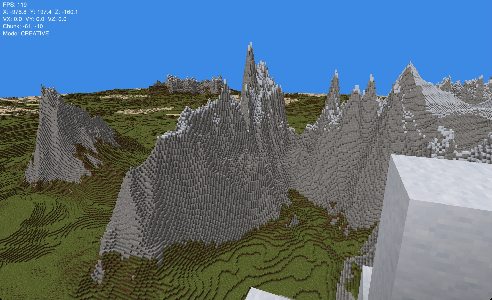
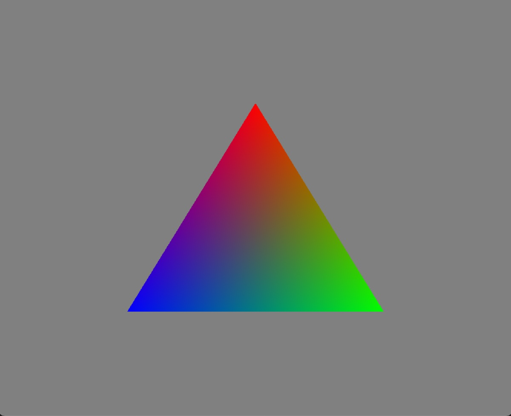
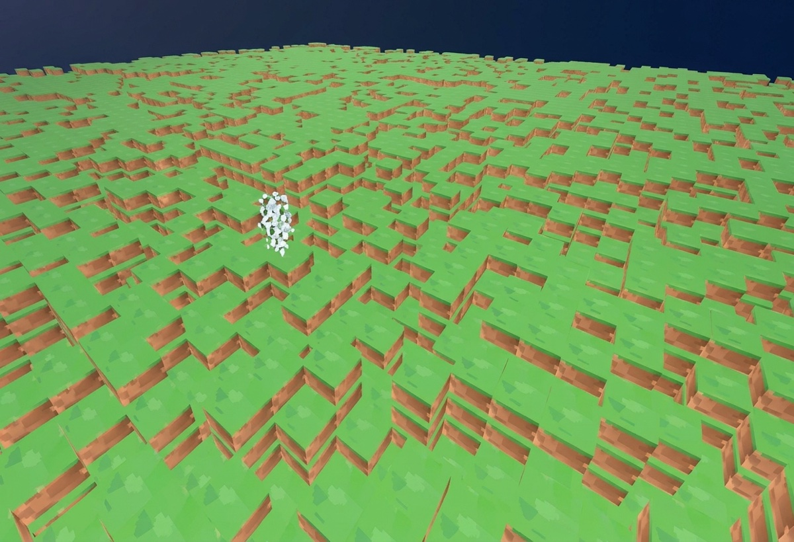
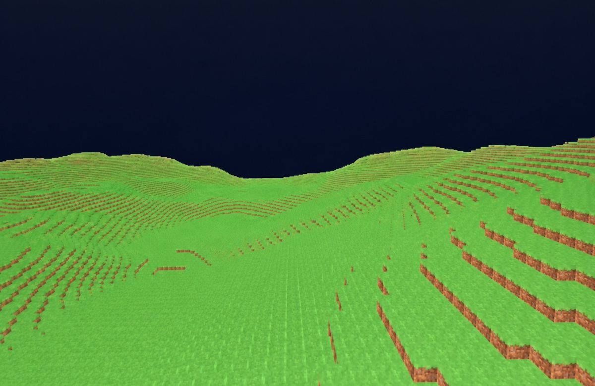
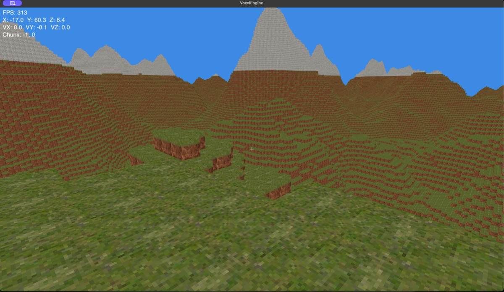
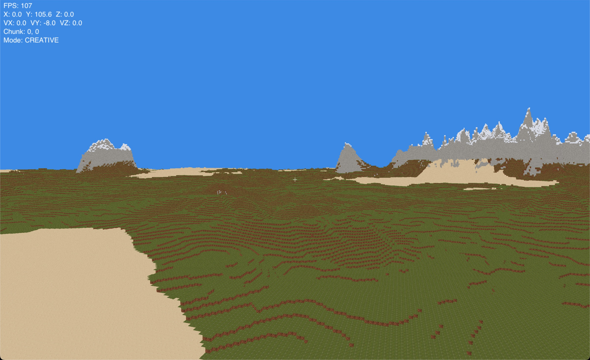

# VoxelEngine

A Minecraft-style voxel engine written from scratch in **Java** with **LWJGL 3** and **OpenGL 3.3**. It generates infinite procedural terrain from Perlin noise, streams chunks in on a background thread, and lets you walk, jump and break blocks in first person.

I built it to learn graphics programming and Java, and eventually to write my own mods for it.


<sub>Snow-capped mountains shaded by sunlight and ambient occlusion, with level of detail drawing terrain out to 128 chunks (about 2,000 blocks), at around 120 FPS on an Apple Silicon Mac. The debug HUD is in the top left.</sub>

---

## Features

- **Procedural terrain**: several layers of Perlin noise build the height map. Most of the world is small rolling hills and sandy deserts with dunes. Rare mountain ranges rise to snow-capped peaks, with bare stone on cliffs. The same seed always gives the same world.
- **Infinite chunk streaming**: 16×256×16 chunks load and unload around the player, nearest first, generated in parallel on a pool of worker threads. Meshes are uploaded to the GPU on the main thread, a few per frame, so the game keeps running smoothly while chunks load.
- **Lighting**: per-vertex ambient occlusion darkens creases and corners, and directional sunlight shades each face by how directly it faces the sun. Both work on near and distant terrain.
- **Distance fog**: terrain fades into the sky colour towards the edge of the render distance, so the world has no visible edge.
- **Skybox**: put six square images named `right.png`, `left.png`, `top.png`, `bottom.png`, `front.png` and `back.png` in `src/main/resources/images/skybox/` and they are loaded as a cube map around the world. The fog samples a blurred version of the same sky, so distant terrain blends into the horizon behind it. With no images, the sky is plain blue.
- **Optimised meshing**: faces hidden by a neighbouring block are skipped, including faces on chunk borders. Each vertex is packed into a single `int`, and blocks are stored in sections so empty air takes no memory.
- **Level of detail**: full-detail chunks are drawn out to 32 chunks. Beyond that, a quadtree swaps in simplified terrain with bigger blocks, so the world is visible out to 128 chunks.
- **Frustum culling**: chunks outside the camera's view are never drawn.
- **Texture atlas**: every block type samples from a single texture, so only one texture is bound per frame.
- **Game modes**: Survival, with health, and Creative, where you can't take damage and can fly. Press `G` to switch.
- **First-person physics**: AABB collision against the voxel grid, gravity, jumping, acceleration, separate ground and air friction, and flight in Creative.
- **Block interaction**: a ray cast from the camera finds the block you are looking at so you can break it. Holding the button keeps breaking at a limited rate.
- **HUD**: a NanoVG overlay with a crosshair, FPS counter, position, velocity, current chunk, game mode and health.
- **Tests and CI**: JUnit 5 unit tests cover the maths, terrain generation, chunks, physics, player and save files. GitHub Actions builds and tests every pull request.

## Development timeline

How the engine got from nothing to where it is now, oldest first. There's more to come.

```
 Jan 2026  ●  1. First triangle
           │
 Feb 2026  ●  2. Blocks & chunks
           │
 Mar 2026  ●  3. Perlin noise terrain
           │
 Mar 2026  ●  4. Physics, HUD & multithreading
           │
 Oct 2026  ●  5. New terrain, game modes & memory optimisations
           │
 Oct 2026  ●  6. Level of detail
           │
 Oct 2026  ◉  7. Lighting & multithreaded loading  ◀ you are here
```

---

### ● Stage 1 · First triangle
**January 2026**



Getting OpenGL running: shaders, a VAO and vertex colours.

<p align="center">⬇</p>

### ● Stage 2 · Blocks & chunks
**February 2026**



A textured, chunked block world with random heights.

<p align="center">⬇</p>

### ● Stage 3 · Perlin noise terrain
**March 2026**



Smooth rolling hills from layered Perlin noise.

<p align="center">⬇</p>

### ● Stage 4 · Physics, HUD & multithreading
**March 2026**



Mountains, stone layers, a sky, physics, a HUD, and multithreaded chunk streaming at 300+ FPS.

<p align="center">⬇</p>

### ● Stage 5 · New terrain, game modes & memory optimisations
**October 2026**

The terrain generator was rewritten with layered height maps for hills, deserts with dunes and rare snow-capped mountain ranges. Survival and Creative game modes, flight, health, unit tests and CI were added.

Large render distances were using several gigabytes of memory, so I measured where it was going and rewrote how chunks are stored and drawn. At a render distance of 32 chunks (4,225 chunks loaded):

| | Before | After |
|---|---|---|
| RAM: leftover mesh build data | ~1.5 GB | 0 |
| RAM: block storage | ~833 MB | ~82 MB |
| VRAM: vertex data | ~306 MB | ~27 MB |
| Faces drawn per chunk | ~600 | ~350 |

- **Mesh building:** vertices are built in a reusable `int[]` and thrown away after upload, instead of an `ArrayList<Float>` that each chunk kept forever.
- **Block storage:** blocks are stored in 16×16×16 sections, and sections that are all air aren't allocated.
- **Packed vertices:** each vertex is packed into a single 4-byte `int`, 4 vertices per face. All chunks share one index buffer, and the vertex shader unpacks the position and texture coordinate.
- **Faster meshing:** neighbouring blocks are read directly from the chunk's data, texture coordinates are cached per block type, and faces under the world floor are skipped.
- **No rebuilds on load:** a chunk is meshed once, when all 4 of its neighbours are loaded. Breaking a block only rebuilds a neighbour when the block is on the shared edge.
- **Drawing:** empty chunks are skipped, culling uses each chunk's real height, and the nearest chunks are drawn first.

**What I learned**

- **Measure before optimising.** I expected the GPU to be the problem, but the biggest cost was a list of vertices that every chunk kept after it had already been uploaded.
- **Boxed types are expensive.** An `ArrayList<Float>` stores every number as a separate object: about 20 bytes per float instead of 4.
- **Nested arrays have a hidden cost.** A `byte[16][256][16]` is 4,113 separate Java objects, each with its own header.
- **Most of a chunk is air.** Terrain rarely goes above y ≈ 80 out of 256, so most of the storage is wasted unless empty sections are skipped.
- **Pack data for the GPU.** A face went from 6 vertices × 5 floats (120 bytes) to 4 vertices × 1 int (16 bytes). The shader does the unpacking for free.
- **Don't draw what can never be seen.** Faces on the bottom of the world were about 40% of every chunk's mesh.
- **Order the work so it only happens once.** Waiting until a chunk's neighbours exist means it's meshed once, instead of being rebuilt every time a neighbour loads.

<p align="center">⬇</p>

### ● Stage 6 · Level of detail
**October 2026**



Full-detail chunks stop at 32 chunks, but the world now stretches to the horizon. Distant mountains, deserts and hills are all visible, at around 100 FPS with a render distance of 128 chunks.

- **Quadtree selection:** the area around the player is split into a quadtree. Chunks within 32 chunks are drawn at full detail, then regions use blocks 2× as big from 32 chunks, 4× from 64 and 8× from 128.
- **LOD meshes straight from the generator:** distant regions are built as 16×16 columns directly from the terrain generator, without storing any block data. Only the mesh is kept.
- **Hiding seams:** column heights round up, and every region edge gets a one-voxel skirt, so no gaps show between detail levels.
- **Scaled in the shader:** LOD voxels are scaled up in the vertex shader with a `voxel_scale` uniform, and the far plane grows to cover the whole render distance.
- **Shared rules:** chunks and LOD regions use the same column surface rules (`TerrainGenerator.describeColumn`) and face tables (`BlockFaces`), so distant terrain matches what you see up close.

<p align="center">⬇</p>

### ◉ Stage 7 · Lighting & multithreaded loading (today)
**October 2026**


The terrain now has depth: creases and the feet of cliffs are darker, and every face is shaded by the sun. Chunks also stream in hundreds of times faster.

**Ambient occlusion**

- **Three blocks per corner:** each corner of a visible face checks the two blocks beside it and the one diagonal to it, giving 4 levels from fully open to fully enclosed.
- **No extra memory:** the level is stored in 2 spare bits of the packed vertex, which stays 4 bytes.
- **Even shading:** each face is split into two triangles along its brighter diagonal, so the darkening doesn't look lopsided.
- **Across chunk borders:** meshing reads all 8 surrounding chunks, so corners are shaded correctly at chunk edges too. Distant LOD terrain is shaded the same way from its column heights.

**Directional sunlight**

- **A sun with a position:** `Sun` has an elevation and azimuth, and each face gets sky light plus sunlight scaled by how directly it faces the sun.
- **Normals for free:** the fragment shader works out each face's direction from how its position changes between neighbouring pixels (`dFdx`/`dFdy`), so the mesh doesn't need to store normals.

**Multithreaded chunk loading**

| | Before | After |
|---|---|---|
| Streaming chunks while moving | ~37 chunks/s | ~9,000 chunks/s |
| Building the spawn area at startup | ~2.1 s | ~0.47 s |

- **Worker pool:** a coordinator thread picks missing chunks nearest first and hands them to a pool of worker threads, one for each core except two.
- **Keeping up with the player:** only a few chunks are queued at a time, and the coordinator rescans from the player's position often, so the nearest chunks are never stuck behind an old backlog.
- **Parallel startup:** the spawn area is generated and its mesh data built on all cores, then uploaded to the GPU on the main thread.

**What I learned**

- **The bottleneck wasn't the CPU.** A chunk takes only ~0.2 ms to generate, but the old loader loaded 2 and then slept for 50 ms. Removing that limit mattered more than adding threads.
- **Read-only data is easy to share.** The terrain generator never changes after it's created, so many threads can use it at once without locks.
- **OpenGL stays on one thread.** Mesh data can be built anywhere, but GPU buffers have to be created on the render thread.

**Next:** placing blocks, saving worlds, biomes, caves and shadows. See the [roadmap](#roadmap).

## Tech stack

| | |
|---|---|
| Language | Java |
| Graphics | OpenGL 3.3 Core via [LWJGL 3.4](https://www.lwjgl.org/) (GLFW, STB, NanoVG) |
| Maths | [JOML](https://github.com/JOML-CI/JOML) |
| Build | Gradle (wrapper included) |
| Testing | JUnit 5, GitHub Actions |

## Getting started

### Requirements

- **macOS on Apple Silicon** (the build currently pulls `natives-macos-arm64`, and the HUD loads the system Helvetica font)
- **JDK 17 or newer** (tested on JDK 25)

You don't need to install Gradle. The `./gradlew` wrapper downloads it for you.

### Run

```bash
git clone https://github.com/Michalkassa/VoxelEngine.git
cd VoxelEngine
./gradlew run
```

The first launch downloads the dependencies. After that, the spawn area is generated before the window starts responding, which takes a moment.

> **Running from an IDE (IntelliJ):** set the main class to `Main`, set the working directory to the project root, and add the VM option `-XstartOnFirstThread`. macOS requires GLFW to run on the main thread, and `./gradlew run` adds this option for you automatically.

### Tests

```bash
./gradlew test
```

### Controls

| Key | Action |
|---|---|
| Mouse | Look around |
| `W` `A` `S` `D` | Move |
| `Space` | Jump |
| Double-tap `Space` | Start or stop flying (Creative) |
| `Space` / `Left Shift` | Fly up / down (while flying) |
| Left click | Break the block under the crosshair (hold to keep breaking) |
| `G` | Switch between Survival and Creative |
| `⌘ Q` | Quit |

## How it works

1. **Generation:** `TerrainGenerator` gives each column a climate (temperature, humidity and elevation) from broad noise fields, after warping the coordinates so nothing lines up on a grid. Each biome in `World.Biome` (ocean, plains, hilly plains, desert, mountains) extends the `Biome` class and declares the climate it prefers, its terrain shape (`TerrainSettings` plus an optional custom `shape()`, such as dunes or ridged peaks) and its blocks (`SurfaceSettings`). Biomes close to the column's climate each shape their own height, and those heights are blended by how close each biome is, so borders never form cliffs. The nearest biome then picks the surface blocks from height and slope, and columns below sea level are filled with water, with sandy beaches along the shore. Grass wears to dirt and then stone gradually, in noisy patches, with thinner soil on steep ground; each biome sets these ranges in its `SurfaceSettings`. To add a biome, subclass `Biome` and register it in `Biomes.ALL`.
2. **Streaming:** `ChunkLoader` runs on its own thread. It works out which chunks fall inside the full-detail distance, nearest first, and hands them to a pool of worker threads that generate their block data in parallel and queue them. Further out, `LodManager` picks LOD regions from a quadtree (`LodSelection`), and `LodMesher` builds their simplified meshes straight from the terrain generator.
3. **Meshing:** each frame, `ChunkManager.buildQueuedMeshes()` meshes up to 2 chunks whose 8 neighbours are all loaded, so each chunk is meshed only once. Only visible faces are emitted, each corner gets an ambient occlusion level, and each vertex is packed into a single `int`.
4. **Rendering:** `Renderer` updates the view frustum. Chunks outside it, and chunks with nothing to draw, are skipped. Full-detail chunks are drawn first, then LOD regions, each nearest first, using one shader, one texture atlas and one shared index buffer. The shader darkens each face by its ambient occlusion and shades it by the sun's direction. The NanoVG HUD is drawn on top.

## Roadmap

- [ ] Block placing and a hotbar
- [ ] Saving and loading worlds
- [ ] Biomes, trees and caves
- [x] Ambient occlusion and directional sunlight
- [ ] Shadows and a day/night cycle
- [ ] Windows and Linux support
- [ ] Modding API

## Credits

The Perlin noise implementation is adapted from [PavlosMak/PerlinNoise](https://github.com/PavlosMak/PerlinNoise).
